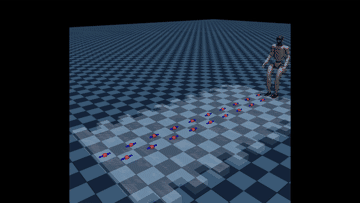
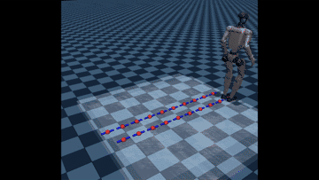
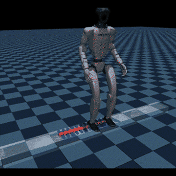
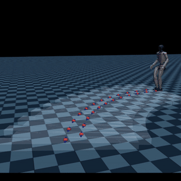
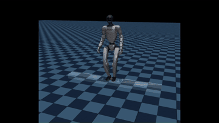
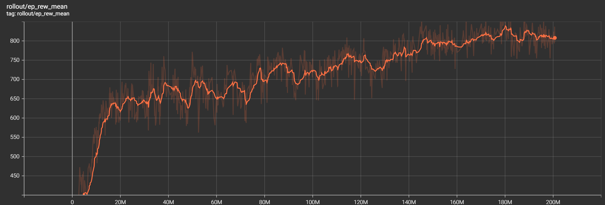
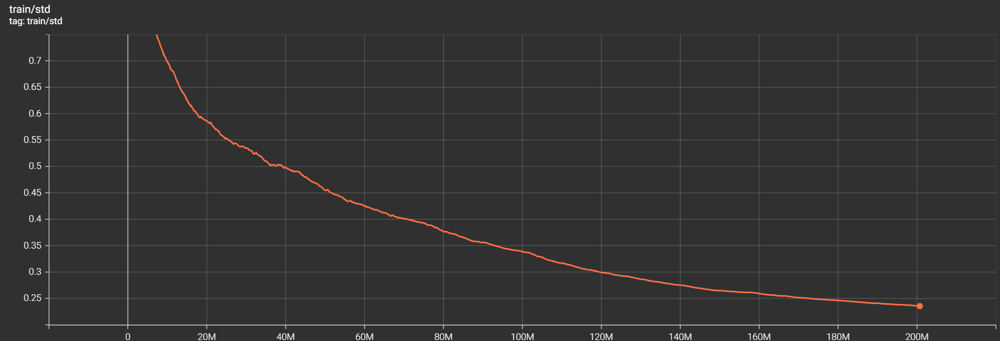
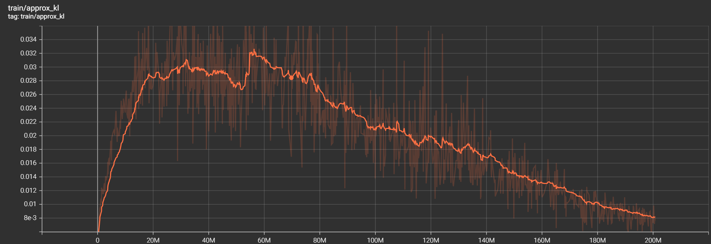
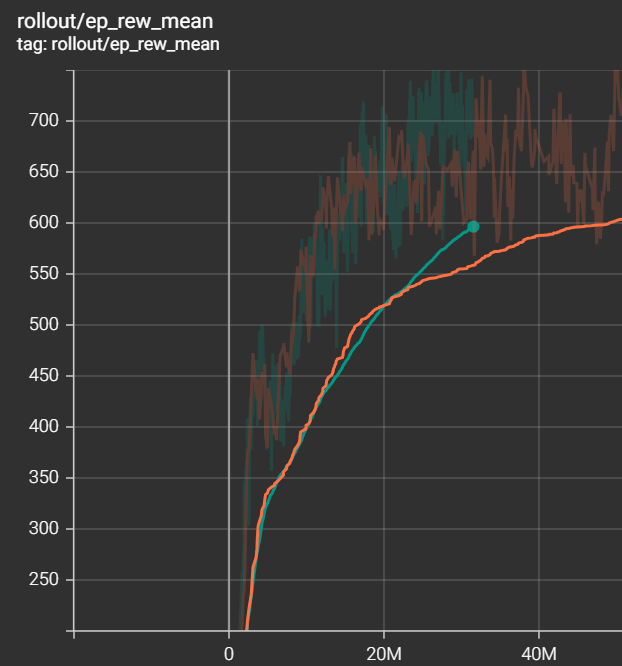
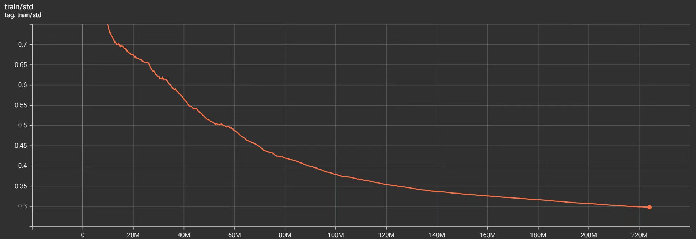

# G1 Omnidirectional Footstep Tracking Control

Deep reinforcement learning based omnidirectional footstep tracking control system for Unitree G1 humanoid robot.

[](https://www.python.org/)
[](https://pytorch.org/)
[](https://mujoco.org/)
[](https://stable-baselines3.readthedocs.io/)
[](LICENSE)
[](https://github.com/psf/black)
[](https://github.com/CYH-SWU/G1_RL_FootstepTracking/actions/workflows/ci.yml)
[](https://github.com/CYH-SWU/G1_RL_FootstepTracking/actions/workflows/lint.yml)


## 🤖Project Overview

This project builds an omnidirectional footstep tracking walking control system for the **Unitree G1** humanoid robot, trained in the **MuJoCo** physics simulation environment using the **PPO** algorithm. The robot receives pre-generated **footstep sequences** (including foot placement positions and orientations). The policy network takes proprioceptive information (joint angles/velocities, IMU attitude) and task instructions (footstep positions/yaws, gait phase) as input, and outputs **12-dimensional joint position** increment commands to drive both legs to accurately **track** each footstep, achieving stable omnidirectional bipedal walking.

---

## ⚙️Environment and Training Setup

### Supported Walking Modes
- FORWARD
- BACKWARD
- LATERAL
- CURVED
- STANDING

### Observation and Action Space

The environment adopts an **asymmetric observation design**: the Actor receives `actor_obs` (41 dims), while the Critic receives `critic_obs` (58 dims), which includes privileged information.

> [!NOTE]
> **Baseline model**: `MultiInputPolicy` (`ppo_G1_FootstepTracking.zip`)(99-dim shared obs no domain rand).
> **Default config**: `AsymmetricPolicy` (41/58-dim separate obs + domain randomization) — fully implemented and validated.  

- **actor_obs (41 dims)**:
Joint angles (12), joint velocities (12), pelvis height (1), current footstep position (3), next footstep position (3), current footstep yaw (1), next footstep yaw (1), gait phase (2), pelvis Euler angles (3), pelvis angular velocity (3).
- **critic_obs (17 + 41 dims)**:
Normalized actor_obs based on prior experience (41), **foot forces** (2), **linear velocity** (3), **joint torques** (12).
- **Action Space**:
12-dimensional continuous values in range [-1,1], mapped to joint angle increments via `action_scale=0.25`.
- **Control Cycle**:
0.015s (approx 66.7Hz), physics step 0.005s (200Hz).

### 🎯Reward Function Design

| Reward term | Weight | Description |
| :--- | :---: | :--- |
| Footstep tracking | 0.45 | Core task reward: drives the robot to step onto target footholds. |
| Foot velocity phase matching | 0.175 | Keeps feet stationary during stance and moving quickly during swing. |
| Foot force phase matching | 0.15 | Press down firmly during stance and lift off during swing. |
| Torso attitude | 0.05 | Aligns pelvis yaw with the target footstep yaw. |
| Pelvis height | 0.05 | Maintains pelvis height near the nominal 0.7268 m. |
| Upper body stability | 0.05 | Minimizes head–pelvis XY distance to reduce torso swaying. |

### 📈 Curriculum Learning (Disabled!)

The environment supports curriculum learning for terrain height (0 → **0.05**m steps) via a built‑in interface (`set_difficulty`). However, for this training run, curriculum learning is **disabled** — all experiments are conducted on flat ground only.

### Data Augmentation and Normalization

- `MirrorWrapper`: 50% probability of flipping observations and actions left-right.
- `actor_obs`: Online normalization via `VecNormalize`. The statistics are updated continuously during training.
- `critic_obs`: Offline fixed normalization using pre‑collected statistics to ensure stable scaling of privileged information.

### 🎲 Domain Randomization

> [!NOTE]
> To improve sim-to-real transfer, the environment supports domain randomization
> during training. It can be disabled entirely with `--no-domain-rand`.

#### Dynamics randomization

| Parameter | Range | Distribution |
| :--- | :--- | :--- |
| Body mass | `±10%` | Uniform |
| Ground friction | `±20%` | Uniform |

#### Observation noise

| Channel | σ | Type |
| :--- | :--- | :--- |
| Joint angles | `0.01` | position |
| Joint velocities | `0.10` | velocity |
| Pelvis height | `0.005` | position |
| Foot position | `0.005` | position |
| Next foot position | `0.005` | position |
| Foot yaw | `0.005` | angle |
| Next foot yaw | `0.005` | angle |
| Phase | `0.005` | sin/cos |
| Pelvis orientation | `0.01` | angle |
| Pelvis angular velocity | `0.05` | angular velocity |

### ⚗️ Distillation

The baseline policy is a privileged RL teacher and is not directly deployable
on the real robot, because its action depends on information unavailable on
hardware. We use DAgger to distill it into a student policy that only observes
deployable proprioceptive signals.

**Teacher** — the pretrained baseline (`MultiInputPolicy`). It consumes the full
observation dict: `actor_obs` (41-dim proprioception) plus `critic_obs` (58-dim
privileged information: foot forces, linear velocity, and joint torques).

**Student** — an actor-only policy. It consumes only `actor_obs`, with the
pelvis-height channel removed (hard to measure on the real robot), stacked over
a history window to partially compensate for the missing privileged information.

### 🧬 Sim2Sim(Isaac Lab)
> [!NOTE]
> **Sim2Sim Migration**
> This project has been migrated from **MuJoCo** to **Isaac Lab**
> - Environment: `DirectRLEnv` with asymmetric Actor‑Critic
> - Training: RSL‑RL (PPO) with massive parallel environments
> - Reward functions: fully migrated (foot placement, gait phase, posture, etc.)
>
> The migration is complete and training‑ready.
>
> The Isaac Lab implementation is maintained in the `feature/migrate-to-isaaclab` branch.

---

## 🏆 Results & Demo

### Demo Videos (Baseline)

#### 🏃 Forward Walking



*If the image(forward.gif) does not load, please view it directly in the `docs/` folder.*


#### 🚶 Backward Walking



*If the image(backward.gif) does not load, please view it directly in the `docs/` folder.*


#### ↔️ Lateral Walking



*If the image(lateral.gif) does not load, please view it directly in the `docs/` folder.*


#### 🔄 Curved Walking



*If the image(curve.gif) does not load, please view it directly in the `docs/` folder.*


#### 🧍 Standing



*If the image(standing.gif) does not load, please view it directly in the `docs/` folder.*

---

### Training Performance (Baseline)


*Mean episodic reward over training iterations. The reward converges after ~**7,000** iterations and stabilizes at approximately **800** in the final phase.*

*If the image(ep_rew_mean.png) does not load, please view it directly in the `docs/` folder.*


*Action standard deviation over training iterations. The value decays from ~**1.0** (initial random exploration) to ~**0.24** (deterministic exploitation).*

*If the image(std.png) does not load, please view it directly in the `docs/` folder.*


*Approximate KL divergence over training iterations. The value remains stable between **0.01** and **0.03**.*

*If the image(approx_kl.png) does not load, please view it directly in the `docs/` folder.*

---

### Eval Results

- **Success** — the full footstep sequence is tracked.
- **Timeout** — the step cap is reached without completing the sequence.
- **Fall** — the robot falls before completing the sequence.

#### Outcome rates

**Baseline**:
| Mode | Success | Fall | Timeout |
|---|---|---|---|
| FORWARD | **0.86** | 0.14 | 0.00 |
| BACKWARD | 0.73 | 0.27 | 0.00 |
| LATERAL | 0.83 | 0.17 | 0.00 |
| CURVED | 0.80 | 0.20 | 0.00 |
| STANDING | N/A | ~0.01 | N/A |

**Student**:
| Mode | Success | Fall | Timeout |
|---|---|---|---|
| FORWARD | 0.85 | 0.15 | 0.00 |
| BACKWARD | **1.00** | 0.00 | 0.00 |
| LATERAL | 0.52 | 0.48 | 0.00 |
| CURVED | 0.79 | 0.21 | 0.00 |
| STANDING | N/A | 0.00 | N/A |

#### Footfall precision

**Baseline**:
| Mode | Hit dist XY (mean) | Hit dist XY (p95) | Hit dist XY (max) | Orient dev (mean abs) | Orient dev (max abs) |
|---|---|---|---|---|---|
| FORWARD | 0.045 | 0.088 | 0.152 | 0.052 | 0.466 |
| BACKWARD | 0.078 | 0.127 | 0.151 | 0.045 | 0.207 |
| LATERAL | 0.059 | 0.117 | 0.154 | 0.030 | 0.229 |
| CURVED | 0.052 | 0.113 | 0.149 | 0.058 | 0.455 |

**Student**:
| Mode | Hit dist XY (mean) | Hit dist XY (p95) | Hit dist XY (max) | Orient dev (mean abs) | Orient dev (max abs) |
|---|---|---|---|---|---|
| FORWARD | 0.045 | 0.089 | 0.153 | 0.051 | 0.233 |
| BACKWARD | 0.071 | 0.120 | 0.138 | 0.040 | 0.108 |
| LATERAL | 0.060 | 0.114 | 0.149 | 0.041 | 0.539 |
| CURVED | 0.053 | 0.114 | 0.151 | 0.060 | 0.396 |

#### Analysis

**Overall.** The distilled student matches the teacher in aggregate: mean
success across the four sequential modes is **0.79 vs 0.805** for the teacher,
and footfall precision is essentially identical on every mode (XY mean
difference < 0.01 m). The policy that the student learns is therefore a faithful
reproduction of the privileged teacher, using only deployable observations.

| Mode | Teacher Success | Student Success | Δ | Teacher Hit XY | Student Hit XY |
| :--- | :---: | :---: | :---: | :---: | :---: |
| FORWARD | 0.86 | 0.85 | −0.01 | 0.045 | 0.045 |
| BACKWARD | 0.73 | 1.00 | +0.27 | 0.078 | 0.071 |
| LATERAL | 0.83 | 0.52 | **−0.31** | 0.059 | 0.060 |
| CURVED | 0.80 | 0.79 | −0.01 | 0.052 | 0.053 |

**LATERAL is the one clear regression.** Student success drops to 0.52
(teacher: 0.83) with a 0.48 fall rate. Placement is not the issue —
`hit_dist_xy` is 0.060 vs 0.059 for the teacher — but the student cannot stay
balanced, showing the largest orientation excursion of any mode (0.539 rad ≈
31°). This is a balance-control failure, not a placement failure, and is
consistent with the removal of the pelvis-height channel: lateral weight
shifting is where pelvis height matters most.

**Failure mode is uniform.** Across both teacher and student, every failure is a
fall; there are no timeouts. The bottleneck is end-of-sequence stability, not
the ability to reach targets.
---

### 💡 Baseline vs. Improved Configuration (`AsymmetricPolicy` + domain randomization)

> [!IMPORTANT]
> To validate the effectiveness of the asymmetric design and domain randomization, we compared the improved configuration against the baseline.

| Configuration | Policy | Domain Randomization | Training Iterations |
| :--- | :--- | :--- | :--- |
| **Baseline** | `MultiInputPolicy` | ❌ Disabled | 7,000 |
| **Improved** | `AsymmetricPolicy` | ✅ Enabled | 1,100 |



AsymmetricPolicy + domain randomization vs. baseline MultiInputPolicy. The improved configuration shows a convergence curve close to the baseline and **slightly outperforms** it.

*If the image(experience.png) does not load, please view it directly in the `docs/` folder.*

---

## 📂 Project Structure

```plaintext
G1_RL_FootstepTracking/
├── env/
│   ├── g1_env.py                       # Main environment class
│   └── utils/                          # Environment modules
│       ├── config.py
│       ├── observation_builder.py
│       ├── reward_calculator.py
│       ├── step_sequence.py
│       └── terrain_generator.py
├── env_utils/                          # Environment utilities
│   ├── mirrorwrapper.py
│   └── reward_functions.py
├── rl/                                 # Training custom modules
│   ├── callbacks.py
│   └── policy.py
├── robot/                              # Robot configuration
│   ├── assets/
│   ├── gen_xml.py
│   └── unitree_g1.xml
├── deploy/                             # Deployment
│   └── ......
├── scripts/                            # Auxiliary scripts
│   └── ......
├── tests/                              # Unit tests (pytest)
│   └── ......
├── pretrained_models/                  # Baseline models
├── pretrained_logs/                    # Baseline logs
├── docs/                               # Documentation assets
├── train.py                            # Main training entry
├── eval.py                             # Model testing entry
└── distill_dagger.py                   # Student distilling
```

## 🔁 Clone the Repository
```bash
git clone https://github.com/CYH-SWU/G1_RL_FootstepTracking.git
cd G1_RL_FootstepTracking
```

## Install Dependencies
```bash
uv sync --all-extras
```
⚠️**Note**: Python 3.12+ is required.


## 🚀 Train the Model
### Generate the processed G1 robot XML file:
```bash
uv run python robot/gen_xml.py
```
### Start training from scratch:
```bash
uv run python train.py
```
```bash
uv run python train.py \
  --iterations 10000 \
  --save_interval 1000 \
  --eval_interval 20
```

## ⚗️ Distilling
```bash
uv run python distill_dagger.py \
    --teacher-model pretrained_models/ppo_G1_FootstepTracking.zip \
    --teacher-vecnorm pretrained_models/vec_normalize.pkl \
    --rounds 600 \
    --save-interval 200
```

## 🎬 Evaluate and Visualize
```bash
uv run python eval.py \
    --model pretrained_models/ppo_G1_FootstepTracking.zip \
    --norm pretrained_models/vec_normalize.pkl \
    --mode FORWARD
```
```bash
uv run python eval.py \
    --eval \
    --model distill_dagger/student_best.pt \
    --norm pretrained_models/vec_normalize.pkl \
    --episodes 100
```

## 🔍 Testing
### Run all unit tests with coverage
```bash
uv run pytest tests/ -v --cov=env --cov=rl --cov=env_utils --cov-report=term
```
### Check code style (Ruff)
```bash
uv run ruff check .
uv run ruff format . --check
```
### Auto-fix style issues
```bash
uv run ruff check . --fix && uv run ruff format .
```

## 🧪 CI/CD
This project uses GitHub Actions to automatically run:
- Unit tests (with coverage) on Python 3.12
- Linting and formatting check with Ruff

All CI jobs must pass before merging a pull request.

---

## 🦾 Deployment

This project includes a deployment skeleton for transferring the distilled
student policy from simulation to the physical Unitree G1 through Unitree SDK2.
**The deployment code is implemented but not yet validated on hardware.**

The deployed controller is the **student** policy produced by distillation, not
the privileged RL teacher. Its observation pipeline mirrors training exactly:
raw proprioception is normalized with the frozen statistics, the pelvis-height
channel is dropped, and the last `history_len` frames are stacked.

### Modules

| File | Purpose |
|---|---|
| `deploy/policy_node.py` | Main loop: LowState → obs → action → LowCmd |
| `deploy/obs_adapter.py` | LowState → 41-dim actor_obs, then `StudentObsPipeline` → flat history window |
| `deploy/state_estimator.py` | Leg-odometry + contact-based pose estimation |
| `deploy/forward_kinematics.py` | MuJoCo FK: joint angles → foot position |
| `deploy/footstep_planner.py` | World-coord footstep sequence + t1/t2 tracking |
| `deploy/transform.py` | World ↔ pelvis-local frame transformations |
| `deploy/safety.py` | Timeout / NaN / tilt / joint-limit monitoring |
| `deploy/joint_map.py` | Sim joint order ↔ real motor index (official G1JointIndex) |
| `scripts/export_actor.py` | Export the distilled student to TorchScript (+ metadata JSON) |
| `deploy/config.yaml` | DDS, PD gains, safety thresholds, student paths |

### Usage (Simulation)

```bash
# 1. Export the distilled student (produces deploy/student.pt + deploy/student.json)
uv run python scripts/export_actor.py \
    --student distill_dagger/student_best.pt \
    --out deploy/student.pt

# 2. Start unitree_mujoco (terminal 1)
cd path/to/unitree_mujoco/simulate/build
./unitree_mujoco

# 3. Run deployment node (terminal 2)
export CYCLONEDDS_URI='<CycloneDDS><Domain><General><Interfaces>
  <NetworkInterface name="lo"/></Interfaces></General></Domain></CycloneDDS>'
python deploy/policy_node.py --config deploy/config.yaml --dryrun

# 4. Remove --dryrun to send actual LowCmd
python deploy/policy_node.py --config deploy/config.yaml --no-dryrun
```

---

## 🎛️ Appendices

### Robot Model and Joint Configuration

- **Degrees of Freedom**: Unitree G1 with 29 DOF, 12 active joints in legs (3x hip, 1x knee, 2x ankle) per side.

- **Nominal Posture**:
    | Joint | Angle (rad) | Angle (deg) |
    |-------|-------------|-------------|
    | Hip pitch   | -0.5236 | -30.0 |
    | Knee pitch  |  0.8727 |  50.0 |
    | Ankle pitch | -0.3491 | -20.0 |
    | Waist pitch |  0.1500 |   8.6 |



*If the image(nominal_pose.jpg) does not load, please view it directly in the `docs/` folder.*

- **PD Controller Gains**:
    | Joint | KP | Dampratio | Torque Limits(Nm) |
    |-------|----|-----------|-------------------|
    | Hip   | 115 | 0.65      | +-139/+-88      |
    | Knee  | 172 | 0.55      | +-139 Nm        |
    | Ankle | 46  | 0.40      | +-50 Nm         |

### Training Hyperparameters

#### Baseline Configuration (MultiInputPolicy)

| Parameter | Value |
| :--- | :--- |
| `n_steps` | 2048 |
| `batch_size` | 64 |
| `n_epochs` | 3 |
| `gamma` | 0.99 |
| `gae_lambda` | 0.95 |
| `clip_range` | 0.18 |
| `learning_rate` | 1e-4 |
| `ent_coef` | 0.0001 |
| `max_grad_norm` | 0.5 |
| `n_envs` | 14 |
| **Network** | 2 × 256 hidden layers |
| **LR callback** | `PlateauLRCallback`|
| **Total timesteps** | 200,704,000 (7,000 iterations) |

#### Student Configuration (Teacher: Baseline)

| Parameter | Value |
| :--- | :--- |
| `rounds` | 600 |
| `steps_per_round` | 8192 |
| `history_len` | 12 |
| `hidden` | 512 × 512 × 256 |
| `updates_per_round` | 2000 |
| `batch_size` | 512 |
| `learning_rate` | 1e-4 |
| `teacher_rollout_ratio` | 0.3 |
| `buffer_size` | 2,000,000 |
| `save_interval` | 200 |
| `eval_interval` | 5 |
| `eval_episodes` | 3 |
| `mirror_prob` | 0.5 |
| **Student input** | `actor_obs` (41) − pelvis height (1) = 40, × 12 history frames = 480 dims |
| **Teacher input** | full dict: `actor_obs` (41) + `critic_obs` (58) |
| **Total environment steps** | 4,915,200 (600 rounds × 8192) |

#### Improved Configuration (AsymmetricPolicy + domain randomization) — Default in train.py

| Parameter | Value |
| :--- | :--- |
| `n_steps` | 2048 |
| `batch_size` | 256 |
| `n_epochs` | 3 |
| `gamma` | 0.99 |
| `gae_lambda` | 0.95 |
| `clip_range` | 0.20 |
| `learning_rate` | 1e-4 |
| `ent_coef` | 0.0005 |
| `max_grad_norm` | 0.5 |
| `n_envs` | 14 |
| **Network** | 2 × 512 hidden layers |
| **LR callback** | `KLAdaptiveLRCallback`|
| **Total timesteps** | 286,720,000 (10,000 iterations) |

### Gait Parameters
```bash
total_duration      1.10s
swing_duration      0.75s
stance_duration     0.35s

step_length         0.20m
step_width          0.237m
```

### 📦 Pretrained Models & Training Logs

The Baseline policy is available in the `pretrained_models/` directory as `ppo_G1_FootstepTracking.zip`. The corresponding TensorBoard logs (including training curves, KL divergence, action std, etc.) can be found in `pretrained_logs/`. To visualize the training process, run:

```bash
tensorboard --logdir pretrained_logs/
```

---

## 📚References
**Learning Humanoid Walking**

R. P. Singh et al., "Learning Bipedal Walking On Planned Footsteps For Humanoid Robots," in *IEEE-RAS Humanoids*, 2022.
R. P. Singh et al., "Learning Bipedal Walking for Humanoids with Current Feedback," *arXiv:2303.03724*, 2023.
R. P. Singh et al., "Robust Humanoid Walking on Compliant and Uneven Terrain with Deep RL," *IEEE Access*, 2024.
GitHub Repository: [https://github.com/rohanpsingh/LearningHumanoidWalking](https://github.com/rohanpsingh/LearningHumanoidWalking)

**Unitree RL Gym**

GitHub Repository: [https://github.com/unitreerobotics/unitree_rl_gym](https://github.com/unitreerobotics/unitree_rl_gym)


## 🎉Acknowledgments

- This project uses the Unitree G1 robot model, which is Copyright (c) 2016-2023 HangZhou YuShu TECHNOLOGY CO.,LTD. and is licensed under the BSD 3-Clause License.
- The footstep tracking framework is inspired by the Learning Humanoid Walking project by Rohan P. Singh, licensed under the BSD 2-Clause License.


## 📄 License

This project is licensed under the MIT License - see the [LICENSE](LICENSE) file for details.